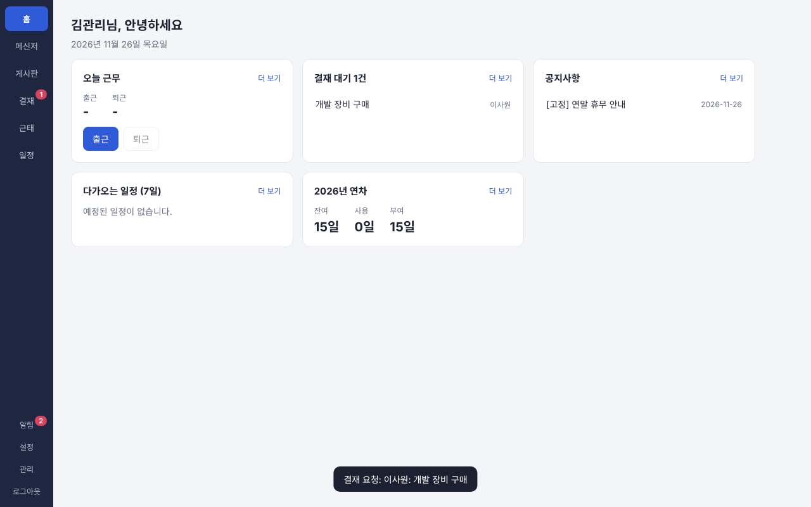
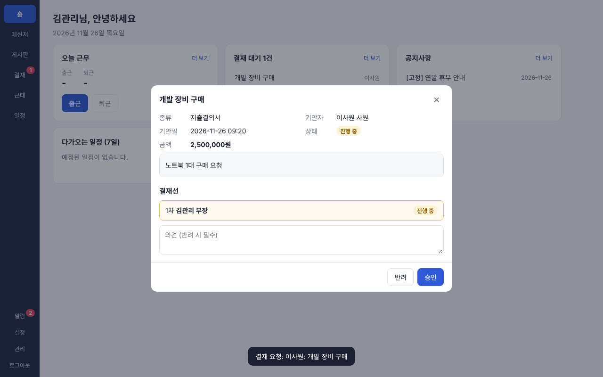

# 사내 ERP (erp-messenger)

회사 직원들이 함께 쓰는 설치형 웹 ERP입니다. 사내 메신저에서 출발해 게시판, 전자결재, 근태·휴가, 일정 기능을 같은 계정과 조직도 위에 얹었습니다.

별도의 데이터베이스 설치가 필요 없고, Node.js만 있으면 명령어 몇 줄로 실행됩니다.



## 주요 기능

| 모듈 | 내용 |
|---|---|
| 홈 | 오늘 출퇴근, 결재 대기 문서, 최근 공지, 다가오는 일정, 연차 현황 요약 |
| 메신저 | 1대1과 그룹 대화, 실시간 전달, 안 읽은 사람 수 표시, 파일 첨부, 메시지 검색, 조직도와 접속 상태 |
| 게시판 | 공지사항(관리자 작성, 상단 고정, 전 직원 알림)과 자유게시판, 댓글 |
| 전자결재 | 품의서와 지출결의서 기안, 결재선 지정(최대 5명, 순차 결재), 승인과 반려, 회수, 결재 알림 |
| 근태·휴가 | 출퇴근 기록, 월별 근무 기록, 휴가 신청(연차, 반차, 병가 등), 잔여 연차, 관리자용 전체 현황 |
| 일정 | 월간 달력, 개인·부서·전사 일정, 승인된 휴가 자동 표시 |
| 알림 | 결재 요청과 결과, 새 공지, 댓글 알림 (화면 알림과 브라우저 알림) |
| 계정과 관리 | 가입과 로그인, 관리자 지정, 계정 사용 중지, 비밀번호 초기화, 연차 부여 일수 설정 |

PC와 모바일 브라우저에서 모두 사용할 수 있습니다.

| 전자결재 | 일정 |
|---|---|
|  |  |

## 모듈 간 연동

- 휴가를 신청하면 전자결재 문서로 올라가고, 최종 승인되면 연차가 차감되며 달력에 표시됩니다.
- 결재 요청, 승인, 반려는 해당 직원에게 바로 알림으로 전달됩니다.
- 모든 모듈이 메신저의 계정, 부서, 직급 정보를 그대로 사용합니다.

## 설치와 실행

필요한 것은 [Node.js](https://nodejs.org/ko) 22.13 이상 하나입니다.

```bash
git clone https://github.com/HYEONGMANHEO/erp-messenger.git
cd erp-messenger
npm install --omit=dev
npm start
```

실행 후 브라우저에서 `http://localhost:3000` 으로 접속합니다. 같은 사내망의 다른 직원은 `http://서버PC의IP주소:3000` 으로 접속합니다.

**가장 먼저 가입한 사람이 관리자가 됩니다.** 설치 직후 담당자가 먼저 가입해 주세요.

깃허브 화면에서 Code 버튼의 Download ZIP으로 내려받아 압축을 푼 뒤 같은 명령을 실행해도 됩니다.

## 윈도우에서 다시 실행하기

한 번 설치한 뒤에는 폴더 안의 실행 파일을 더블클릭하면 됩니다.

| 파일 | 용도 |
|---|---|
| `start-server.bat` | 메신저 서버만 실행 (같은 사내망에서 사용할 때) |
| `start-with-tunnel.bat` | 메신저 서버와 외부 접속용 터널을 함께 실행 |

명령어로 직접 실행하려면 cmd에서 폴더로 이동한 뒤 `npm start`를 입력합니다. PC를 껐다 켜도 계정과 대화 내용은 `data` 폴더에 그대로 남아 있습니다.

## 외부에서 접속하기 (시험용 터널)

서로 다른 장소에 있는 사람들과 시험해 보려면 [Cloudflare Quick Tunnel](https://developers.cloudflare.com/tunnel/get-started/quick-tunnels/)을 사용할 수 있습니다. 계정이나 도메인 없이 임시 HTTPS 주소가 만들어집니다.

1. 터널 프로그램 설치 (한 번만): `winget install --id Cloudflare.cloudflared`
2. `.env` 파일에 `SIGNUP_CODE`, `COOKIE_SECURE=true`, `TRUST_PROXY=true` 설정
3. 터널을 열기 전에 `http://localhost:3000`에서 관리자 계정을 먼저 가입
4. `start-with-tunnel.bat` 실행 (또는 서버 실행 후 다른 창에서 `cloudflared tunnel --url http://localhost:3000`)
5. 화면에 표시된 `https://....trycloudflare.com` 주소와 가입 코드를 동료에게 공유

유의 사항:

- 터널을 다시 실행할 때마다 주소가 바뀝니다.
- 서버 PC와 실행 창이 켜져 있는 동안에만 접속됩니다.
- 주소를 아는 사람은 누구나 로그인 화면에 접근할 수 있으므로 가입 코드를 반드시 설정해 주세요.
- 가동 시간이 보장되지 않는 시험용 서비스입니다. 계속 사용하려면 클라우드 서버에 설치하고 도메인과 HTTPS를 적용하는 구성을 권장합니다.

## 설정

`.env.example` 파일을 `.env` 로 복사한 뒤 필요한 값을 수정합니다.

| 항목 | 기본값 | 설명 |
|---|---|---|
| `PORT` | 3000 | 서버 포트 |
| `SIGNUP_CODE` | 없음 | 가입 코드. 설정하면 두 번째 가입자부터 코드를 입력해야 가입 가능 |
| `MAX_FILE_MB` | 20 | 첨부 파일 최대 크기 |
| `SESSION_DAYS` | 14 | 로그인 유지 기간 |
| `TIMEZONE` | Asia/Seoul | 출퇴근 날짜를 계산할 기준 시간대 |
| `DATA_DIR` | `./data` | 데이터베이스와 첨부 파일 저장 폴더 |
| `COOKIE_SECURE` | false | HTTPS로 서비스할 때 true |
| `TRUST_PROXY` | false | 역방향 프록시 뒤에서 실행할 때 true |

## 실제 업무에 쓰기 전 확인 사항

- **가입 코드 설정**: `SIGNUP_CODE`를 비워 두면 접속 가능한 누구나 가입할 수 있습니다.
- **HTTPS 적용**: 사내망 밖에서도 접속하게 하려면 Nginx나 Caddy 같은 역방향 프록시로 HTTPS를 적용하고, `COOKIE_SECURE=true`, `TRUST_PROXY=true` 로 설정해 주세요. HTTPS 없이 인터넷에 공개하면 비밀번호와 대화 내용이 노출될 수 있습니다.
- **백업**: 모든 데이터(계정, 대화, 게시글, 결재, 근태, 일정)는 `data` 폴더(데이터베이스 `messenger.db`와 `uploads` 폴더)에 있습니다. 이 폴더를 주기적으로 복사해 두면 됩니다.
- **계속 실행**: 서버 PC를 재시작해도 자동 실행되도록 하려면 [PM2](https://pm2.keymetrics.io/) 같은 프로세스 관리 도구나 운영체제의 서비스 등록 기능을 사용합니다.

## 현재 버전의 한계

- 서버 한 대에서 실행하는 구조입니다. 수십 명에서 수백 명 규모의 사내 사용을 전제로 합니다.
- 대화와 문서 내용은 서버 데이터베이스에 그대로 저장됩니다(종단간 암호화 아님). 비밀번호는 복원할 수 없는 형태로 변환하여 저장합니다.
- 연차 부여 일수는 관리자가 직접 입력합니다(기본 15일). 입사일 기준 자동 계산과 공휴일 자동 제외는 지원하지 않습니다.
- 결재 양식은 품의서, 지출결의서, 휴가신청서 세 가지이며, 문서 첨부 파일과 양식 편집 기능은 없습니다.
- 메시지 수정과 삭제, 반복 일정, 회계와 급여, 휴대폰 앱 알림은 아직 없습니다.

## 이전 버전에서 올리기

`git pull` 후 서버를 다시 실행하면 됩니다. 기존 계정과 대화 내용은 그대로 유지되며, 새 기능에 필요한 데이터 구조는 실행 시 자동으로 추가됩니다.

## 폴더 구조

```
server.js               서버 본체 (계정, 메신저, 알림, 실시간 통신)
src/db.js               데이터베이스 구조 정의
src/modules/            ERP 모듈별 서버 기능 (board, approval, attendance, calendar)
public/app.js           화면 공통 기능과 메신저 화면
public/modules/         모듈별 화면 (home, board, approval, attendance, calendar)
test/smoke.js           주요 기능 자동 점검 스크립트
start-server.bat        윈도우용 서버 실행 파일
start-with-tunnel.bat   윈도우용 서버와 터널 동시 실행 파일
data/                   실행 시 생성되는 데이터 폴더 (저장소에는 포함되지 않음)
```

## 기술 구성

| 영역 | 사용 기술 |
|---|---|
| 서버 | Node.js, Express |
| 실시간 통신 | Socket.IO (WebSocket) |
| 저장소 | Node.js 내장 SQLite |
| 화면 | 빌드 과정이 없는 순수 HTML, CSS, JavaScript |

## 점검 스크립트 실행

```bash
npm install
npm test
```

메신저, 게시판, 전자결재, 근태·휴가, 일정, 알림, 권한 등 31개 항목을 임시 데이터로 자동 확인합니다.

## 다음 확장 방향

1. 결재 문서 첨부 파일과 양식 추가
2. 입사일 기준 연차 자동 계산과 공휴일 반영
3. 회의실과 공용 자원 예약
4. 프로젝트와 투입 인력 관리, 경비 정산

## 라이선스

[MIT](LICENSE). 누구나 자유롭게 사용, 수정, 배포할 수 있습니다.
