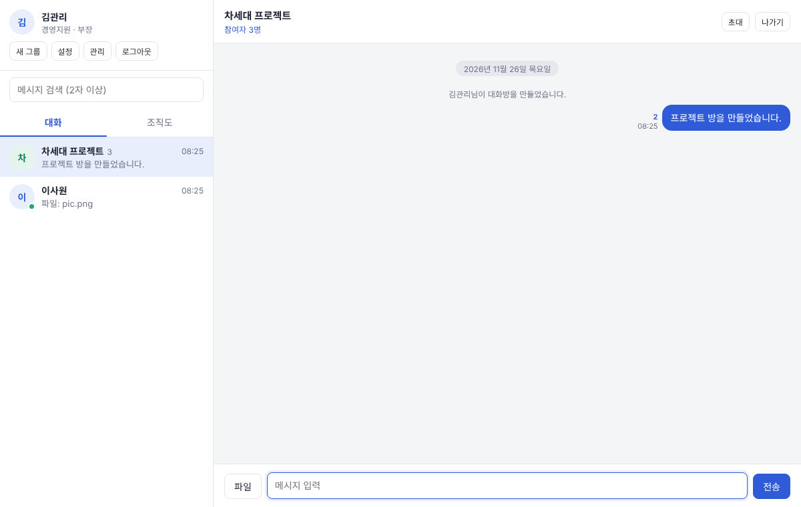

# 사내 메신저 (erp-messenger)

회사 직원들이 함께 쓰는 설치형 웹 메신저입니다. 사내 ERP를 단계적으로 만들어 가기 위한 첫 번째 모듈로, 이후 전자결재나 근태 같은 기능이 같은 계정과 조직도 위에 추가될 수 있도록 구성했습니다.

별도의 데이터베이스 설치가 필요 없고, Node.js만 있으면 명령어 세 줄로 실행됩니다.



## 주요 기능

| 구분 | 내용 |
|---|---|
| 계정 | 가입, 로그인, 내 정보 수정, 비밀번호 변경 |
| 조직도 | 부서별 직원 목록, 접속 상태 표시 |
| 대화 | 1대1 대화, 그룹 대화방 생성, 초대, 나가기 |
| 메시지 | 실시간 전달, 대화 내용 저장, 이전 메시지 불러오기, 안 읽은 사람 수 표시 |
| 파일 | 첨부 파일 전송과 내려받기, 이미지 미리보기, 끌어다 놓기와 붙여넣기 |
| 검색 | 내가 참여한 대화방의 메시지 검색 |
| 알림 | 안 읽은 메시지 수, 브라우저 알림 |
| 관리 | 관리자 지정, 계정 사용 중지, 비밀번호 초기화 |
| 화면 | PC와 모바일 브라우저 지원 |

## 설치와 실행

필요한 것은 [Node.js](https://nodejs.org/ko) 22.13 이상 하나입니다.

```bash
git clone https://github.com/HYEONGMANHEO/erp-messenger.git
cd erp-messenger
npm install --omit=dev
npm start
```

실행 후 브라우저에서 `http://localhost:3000` 으로 접속합니다. 같은 사내망의 다른 직원은 `http://서버PC의IP주소:3000` 으로 접속합니다.

**가장 먼저 가입한 사람이 관리자가 됩니다.** 설치 직후 담당자가 먼저 가입해 주세요.

깃허브 화면에서 Code 버튼의 Download ZIP으로 내려받아 압축을 푼 뒤 같은 명령을 실행해도 됩니다.

## 설정

`.env.example` 파일을 `.env` 로 복사한 뒤 필요한 값을 수정합니다.

| 항목 | 기본값 | 설명 |
|---|---|---|
| `PORT` | 3000 | 서버 포트 |
| `SIGNUP_CODE` | 없음 | 가입 코드. 설정하면 두 번째 가입자부터 코드를 입력해야 가입 가능 |
| `MAX_FILE_MB` | 20 | 첨부 파일 최대 크기 |
| `SESSION_DAYS` | 14 | 로그인 유지 기간 |
| `DATA_DIR` | `./data` | 데이터베이스와 첨부 파일 저장 폴더 |
| `COOKIE_SECURE` | false | HTTPS로 서비스할 때 true |
| `TRUST_PROXY` | false | 역방향 프록시 뒤에서 실행할 때 true |

## 실제 업무에 쓰기 전 확인 사항

- **가입 코드 설정**: `SIGNUP_CODE`를 비워 두면 접속 가능한 누구나 가입할 수 있습니다.
- **HTTPS 적용**: 사내망 밖에서도 접속하게 하려면 Nginx나 Caddy 같은 역방향 프록시로 HTTPS를 적용하고, `COOKIE_SECURE=true`, `TRUST_PROXY=true` 로 설정해 주세요. HTTPS 없이 인터넷에 공개하면 비밀번호와 대화 내용이 노출될 수 있습니다.
- **백업**: 모든 데이터는 `data` 폴더(데이터베이스 `messenger.db`와 `uploads` 폴더)에 있습니다. 이 폴더를 주기적으로 복사해 두면 됩니다.
- **계속 실행**: 서버 PC를 재시작해도 자동 실행되도록 하려면 [PM2](https://pm2.keymetrics.io/) 같은 프로세스 관리 도구나 운영체제의 서비스 등록 기능을 사용합니다.

## 현재 버전의 한계

- 서버 한 대에서 실행하는 구조입니다. 수십 명에서 수백 명 규모의 사내 사용을 전제로 합니다.
- 대화 내용은 서버 데이터베이스에 그대로 저장됩니다(종단간 암호화 아님). 비밀번호는 복원할 수 없는 형태로 변환하여 저장합니다.
- 메시지 수정과 삭제, 답장, 공지, 휴대폰 앱 알림은 아직 없습니다.

## 폴더 구조

```
server.js        서버 (REST API, 실시간 통신, 권한 확인)
src/db.js        데이터베이스 구조 정의
public/          화면 (index.html, app.js, style.css)
test/smoke.js    주요 기능 자동 점검 스크립트
data/            실행 시 생성되는 데이터 폴더 (저장소에는 포함되지 않음)
```

## 기술 구성

| 영역 | 사용 기술 |
|---|---|
| 서버 | Node.js, Express |
| 실시간 통신 | Socket.IO (WebSocket) |
| 저장소 | Node.js 내장 SQLite |
| 화면 | 빌드 과정이 없는 순수 HTML, CSS, JavaScript |

## 점검 스크립트 실행

```bash
npm install
npm test
```

가입, 권한, 대화, 읽음 처리, 파일, 검색 등 21개 항목을 임시 데이터로 자동 확인합니다.

## ERP 확장 방향

메신저의 계정(`users`)과 부서 정보는 이후 모듈이 그대로 재사용할 수 있습니다.

1. 공지사항과 게시판
2. 전자결재 (결재 요청과 승인 알림을 메신저 메시지로 전달)
3. 근태와 휴가 관리
4. 일정과 회의실 예약

## 라이선스

[MIT](LICENSE). 누구나 자유롭게 사용, 수정, 배포할 수 있습니다.
